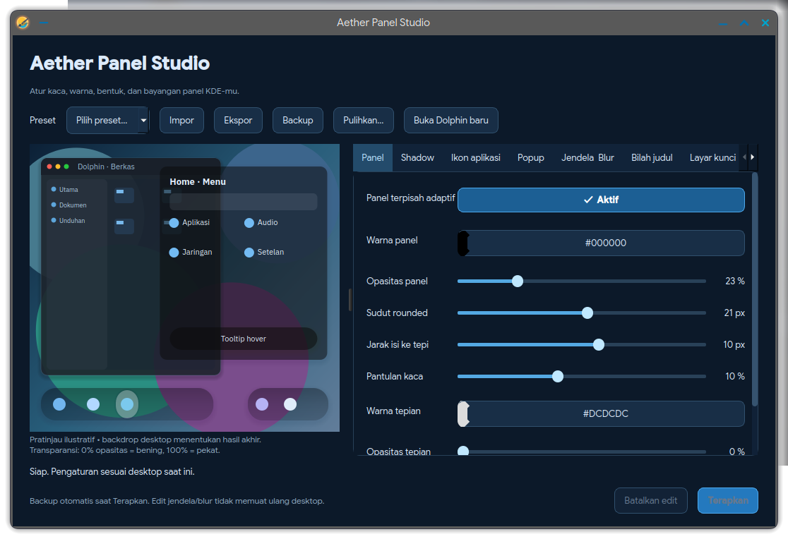
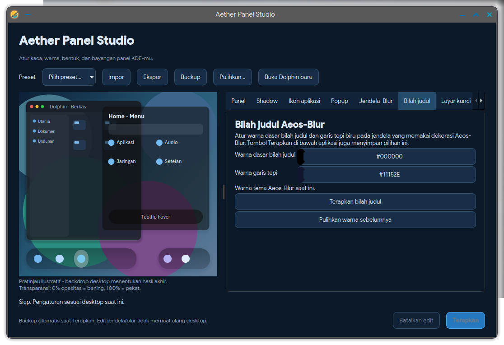
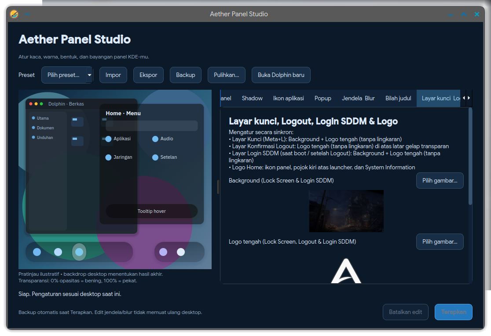
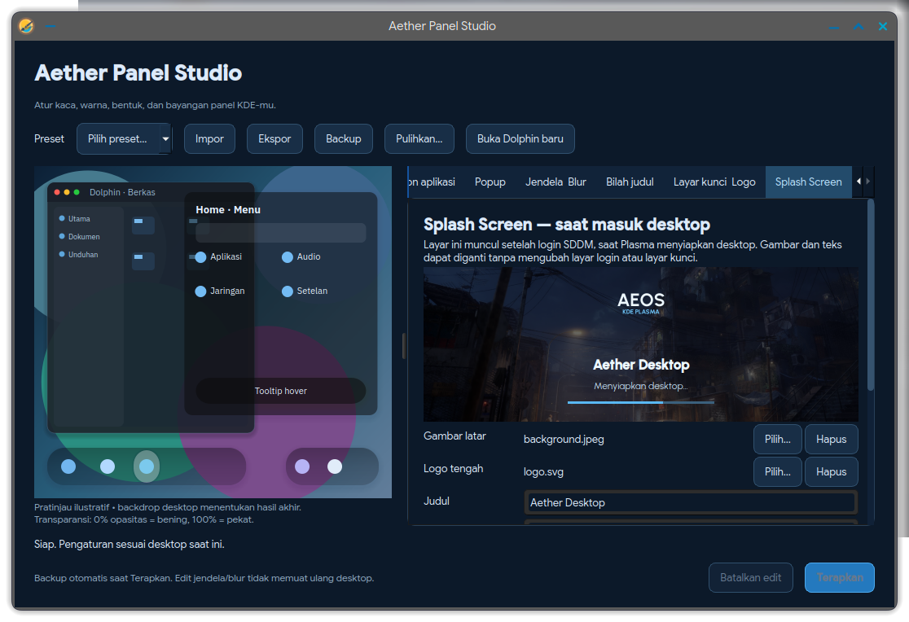

# Aether Kubuntu Remaster

Panduan per sesi, peta file dan kode, serta screenshot antarmuka.

Target: Kubuntu 24.04 x86_64, Plasma 5.27.

Dokumen ini menggabungkan bahan bacaan; pemasangan tetap dilakukan per modul, bukan dengan satu installer.


<div style="page-break-before:always"></div>

# 00 — Persiapan Cubic

Buat proyek dari ISO Kubuntu 24.04 x86_64, lalu masuk Terminal Cubic (sudah root). Salin folder repositori beserta aset lokal ke /tmp. Jangan menggunakan file akun pribadi sebagai bahan ISO.

## Langkah manual

```sh
R=/tmp/aether-kubuntu-remaster
cat /etc/os-release
apt-get update
apt-get install -y python3-pyqt5 qt5-style-kvantum fonts-ibm-plex
mkdir -p /var/backups/aether-sessions
cp -a /etc/skel /var/backups/aether-sessions/00-original-skel
cp -a "$R/modules/00-persiapan/root/." /
cp -a "$R/modules/00-persiapan/skel/." /etc/skel/
chmod 755 /etc/skel/.config/plasma-workspace/env/00-aether-remaster-relocate.sh
```

## File dan kode yang terkait

Hook env berjalan sebelum Plasma untuk mengganti path `/home/aether` menjadi home akun baru. Source berada di `root/usr/local/lib/aether-remaster/relocate.py`. Ini hanya penyesuai path, bukan pemasang seluruh modul. Biarkan hook tersedia sebelum sesi 04–08. Terminal Cubic tidak menjalankan desktop; lihat hasil setelah boot VM.

Lihat `MANIFEST.json` untuk daftar payload dan checksum berkas sesi ini. Nilai ID widget pada snapshot berasal dari desktop sumber; instalasi lain dapat memiliki ID berbeda.


<div style="page-break-before:always"></div>

# 01 — Font

Pasang file font, lalu terapkan pilihan global tanpa mengganti warna/ikon desktop.

Prasyarat: 00-persiapan. Jalankan di Terminal Cubic setelah `R=/tmp/aether-kubuntu-remaster`.

Sebelum menyalin, simpan `/etc/skel` dengan nama sesi:

```sh
mkdir -p /var/backups/aether-sessions
cp -a /etc/skel /var/backups/aether-sessions/01-font-skel
```

Gunakan nama backup baru jika mengulang sesi; jangan menumpuk ke folder backup yang sama.

## Langkah manual

```sh
mkdir -p /usr/local/share/fonts
cp -a "$R/private-assets/fonts/." /usr/local/share/fonts/
fc-cache -f /usr/local/share/fonts
cp -a "$R/modules/01-font/skel/." /etc/skel/
python3 "$R/tools/merge-kconfig.py" "$R/modules/01-font/config/kdeglobals.ini" /etc/skel/.config/kdeglobals
```

## File dan kode yang terkait

`config/kdeglobals.ini` hanya memuat key font (Google Sans global, IBM Plex Sans taskbar dan font WM). `skel/.config/fontconfig/fonts.conf` mengatur fontconfig. Urbanist jam 12 pt berada di sesi panel; Urbanist splash berada di sesi splash; IBM Plex Mono terminal berada di sesi Konsole. Untuk mengubah font setelah instalasi: System Settings → Fonts; jam melalui Configure Digital Clock. Aset font eksternal berada di private-assets dan tidak ikut GitHub secara default.

Lihat `MANIFEST.json` untuk daftar payload dan checksum berkas sesi ini. Nilai ID widget pada snapshot berasal dari desktop sumber; instalasi lain dapat memiliki ID berbeda.


<div style="page-break-before:always"></div>

# 02 — Tema ikon

Pasang tema ikon global dan pilih namanya untuk akun baru.

Prasyarat: 00-persiapan. Jalankan di Terminal Cubic setelah `R=/tmp/aether-kubuntu-remaster`.

Sebelum menyalin, simpan `/etc/skel` dengan nama sesi:

```sh
mkdir -p /var/backups/aether-sessions
cp -a /etc/skel /var/backups/aether-sessions/02-ikon-skel
```

Gunakan nama backup baru jika mengulang sesi; jangan menumpuk ke folder backup yang sama.

## Langkah manual

```sh
mkdir -p /usr/share/icons
cp -a "$R/private-assets/icons/Vivid-Glassy-Dark-Icons" /usr/share/icons/
python3 "$R/tools/merge-kconfig.py" "$R/modules/02-ikon/config/kdeglobals.ini" /etc/skel/.config/kdeglobals
```

## File dan kode yang terkait

Target `/usr/share/icons/Vivid-Glassy-Dark-Icons/index.theme` menentukan nama dan pewarisan ikon. Key `[Icons] Theme` pada kdeglobals memilih tema. Logo Home adalah gambar branding terpisah (sesi 06); memilih tema ikon tidak mengganti semua logo branding.

Lihat `MANIFEST.json` untuk daftar payload dan checksum berkas sesi ini. Nilai ID widget pada snapshot berasal dari desktop sumber; instalasi lain dapat memiliki ID berbeda.


<div style="page-break-before:always"></div>

# 03 — Appearance dan kaca

Tiga lapisan: Aeos untuk popup/Plasma, Aeos-Blur untuk bilah judul, dan Kvantum AetherGlass untuk permukaan aplikasi Qt.

Prasyarat: 00-persiapan; font dan ikon dianjurkan. Jalankan di Terminal Cubic setelah `R=/tmp/aether-kubuntu-remaster`.

Sebelum menyalin, simpan `/etc/skel` dengan nama sesi:

```sh
mkdir -p /var/backups/aether-sessions
cp -a /etc/skel /var/backups/aether-sessions/03-appearance-glass-skel
```

Gunakan nama backup baru jika mengulang sesi; jangan menumpuk ke folder backup yang sama.

## Langkah manual

```sh
mkdir -p /etc/skel/.local/share /etc/skel/.config
cp -a "$R/private-assets/appearance/share/." /etc/skel/.local/share/
cp -a "$R/private-assets/appearance/config/." /etc/skel/.config/
python3 "$R/tools/merge-kconfig.py" "$R/modules/03-appearance-glass/config/kdeglobals.ini" /etc/skel/.config/kdeglobals
python3 "$R/tools/merge-kconfig.py" "$R/modules/03-appearance-glass/config/kwinrc.ini" /etc/skel/.config/kwinrc
python3 "$R/tools/merge-kconfig.py" "$R/modules/03-appearance-glass/config/plasmarc.ini" /etc/skel/.config/plasmarc
```

## File dan kode yang terkait

Kvantum memilih AetherGlass lewat `.config/Kvantum/kvantum.kvconfig`; tema berada di `Kvantum/AetherGlass/`. Aeos berada di `.local/share/plasma/desktoptheme/Aeos`; dekorasi di `.local/share/aurorae/themes/Aeos-Blur/decoration.svg`. Fragment ini mengaktifkan blur KWin bawaan.

Efek VM kompatibilitas **opsional** hanya boleh dipakai jika `dpkg-query -W -f='${Version}' kwin-x11` menghasilkan `4:5.27.11-0ubuntu3`. Binary lokal berada di `private-assets/compat`, source di `source/compat-blur`. Jangan menyalin binary itu pada versi KWin berbeda. Untuk memakai binary yang cocok: salin direktori aether-kvantum ke `/etc/skel/.local/opt/`, buat env yang menambahkan direktori plugin Qt5 itu ke QT_PLUGIN_PATH, lalu pilih `blurEnabled=false` dan `aether-compat-blurEnabled=true` pada kwinrc. Verifikasi di sesi X11 sebelum mengemas ISO. Studio akan memilih plugin kompatibilitas bila binary tersedia; untuk tetap menggunakan native, buat marker `/etc/skel/.config/aether-panel-studio-use-stock-blur`.

Lihat `MANIFEST.json` untuk daftar payload dan checksum berkas sesi ini. Nilai ID widget pada snapshot berasal dari desktop sumber; instalasi lain dapat memiliki ID berbeda.

## Perintah opsional untuk plugin VM dengan versi cocok

Jalankan bagian ini hanya setelah versi KWin diverifikasi persis. Untuk target lain tetap gunakan langkah utama blur native.

```sh
mkdir -p /etc/skel/.local/opt /etc/skel/.config/plasma-workspace/env
cp -a "$R/private-assets/compat/aether-kvantum" /etc/skel/.local/opt/
cat > /etc/skel/.config/plasma-workspace/env/aether-qt-style.sh <<'ENV'
#!/bin/sh
export QT_PLUGIN_PATH="$HOME/.local/opt/aether-kvantum/usr/lib/x86_64-linux-gnu/qt5/plugins${QT_PLUGIN_PATH:+:$QT_PLUGIN_PATH}"
ENV
chmod 755 /etc/skel/.config/plasma-workspace/env/aether-qt-style.sh
kwriteconfig5 --file /etc/skel/.config/kwinrc --group Plugins --key blurEnabled false
kwriteconfig5 --file /etc/skel/.config/kwinrc --group Plugins --key aether-compat-blurEnabled true
```


<div style="page-break-before:always"></div>

# 04 — Panel terpisah adaptif

Pasang widget dan layout panel. Perubahan di sini mengatur panel, bukan memasang aplikasi Studio.

Prasyarat: 00-persiapan, 03-appearance-glass; 05 untuk helper blur panel. Jalankan di Terminal Cubic setelah `R=/tmp/aether-kubuntu-remaster`.

Sebelum menyalin, simpan `/etc/skel` dengan nama sesi:

```sh
mkdir -p /var/backups/aether-sessions
cp -a /etc/skel /var/backups/aether-sessions/04-panel-terpisah-skel
```

Gunakan nama backup baru jika mengulang sesi; jangan menumpuk ke folder backup yang sama.

## Langkah manual

```sh
mkdir -p /etc/skel/.local/share
cp -a "$R/private-assets/panel/share/." /etc/skel/.local/share/
cp -a "$R/modules/04-panel-terpisah/skel/." /etc/skel/
python3 "$R/tools/merge-kconfig.py" "$R/modules/04-panel-terpisah/config/plasma-layout.ini" /etc/skel/.config/plasma-org.kde.plasma.desktop-appletsrc
```

## File dan kode yang terkait

`contents/ui/main.qml` widget menghitung dua latar pada `updateBackgrounds()`. `splitPanel=1` mengaktifkan pemisahan visual; `backgroundOpacity=0.23`, `cornerRadius=21` dan `contentMargin=10` mengatur kaca. Kontainer tetap satu panel Plasma. Celah spacer tidak digambar dan region blur mengikuti bidang yang terlihat lewat helper panel_blur.py milik Studio; karena itu sesi 05 diperlukan untuk blur panel khusus.

Layout snapshot: Home 28; aplikasi 30; tray 32; jam 45; baterai 87; Show Desktop 46. `AppletOrder=82;80;28;31;30;81;32;45;87;46`. ID tersebut bukan nilai universal. Setelah boot: klik kanan panel → Edit Mode, seret baterai atau widget, lalu keluar mode edit. Urbanist jam, tanggal bertumpuk, dan spacer fleksibel sudah disimpan. Wallpaper serta Home logo dipasang pada sesi 06.

Dua template QML harus tetap sinkron: widget aktif di modul 04 dan `data/main.qml` di modul 05. Studio menyalin template miliknya saat Terapkan.

Lihat `MANIFEST.json` untuk daftar payload dan checksum berkas sesi ini. Nilai ID widget pada snapshot berasal dari desktop sumber; instalasi lain dapat memiliki ID berbeda.





<div style="page-break-before:always"></div>

# 05 — Aether Panel Studio

Pasang aplikasi Python/PyQt5 dan launcher. Kode dapat ditinjau terpisah dari aset tema.

Prasyarat: 00-persiapan, 03-appearance-glass, 04-panel-terpisah. Jalankan di Terminal Cubic setelah `R=/tmp/aether-kubuntu-remaster`.

Sebelum menyalin, simpan `/etc/skel` dengan nama sesi:

```sh
mkdir -p /var/backups/aether-sessions
cp -a /etc/skel /var/backups/aether-sessions/05-panel-studio-skel
```

Gunakan nama backup baru jika mengulang sesi; jangan menumpuk ke folder backup yang sama.

## Langkah manual

```sh
cp -a "$R/modules/05-panel-studio/skel/." /etc/skel/
chmod 755 /etc/skel/.local/bin/aether-panel-studio
```

## File dan kode yang terkait

`app.py` mendefinisikan tab/kontrol; `backend.py` memetakan key ke konfigurasi widget dan menulis SVG/Kvantum/KWin. `branding.py`, `splash.py`, `titlebar.py` menangani tab khusus. Setelah boot cari Aether Panel Studio di launcher. Tab Panel → Panel terpisah adaptif mengubah splitPanel; tekan Terapkan.

Studio memerlukan tema Aeos dan widget Panel Islands aktif. Tab branding/splash paling lengkap setelah sesi 06/07. App belum berupa paket .deb; saat ini launcher dan source disalin ke home akun baru. Impor/ekspor JSON hanya pengaturan Studio, bukan ekspor seluruh distro.

Lihat `MANIFEST.json` untuk daftar payload dan checksum berkas sesi ini. Nilai ID widget pada snapshot berasal dari desktop sumber; instalasi lain dapat memiliki ID berbeda.





<div style="page-break-before:always"></div>

# 06 — Wallpaper dan seluruh branding

Pisahkan wallpaper desktop, logo Home, logo tengah lock/logout, dan tema login SDDM.

Prasyarat: 00-persiapan, 03-appearance-glass, 04-panel-terpisah; 05 untuk editor. Jalankan di Terminal Cubic setelah `R=/tmp/aether-kubuntu-remaster`.

Sebelum menyalin, simpan `/etc/skel` dengan nama sesi:

```sh
mkdir -p /var/backups/aether-sessions
cp -a /etc/skel /var/backups/aether-sessions/06-wallpaper-branding-skel
```

Gunakan nama backup baru jika mengulang sesi; jangan menumpuk ke folder backup yang sama.

## Langkah manual

```sh
mkdir -p /etc/skel/.local/share /etc/skel/Downloads /usr/share/sddm/themes
cp -a "$R/private-assets/branding/share/." /etc/skel/.local/share/
cp -a "$R/private-assets/wallpaper/." /etc/skel/Downloads/
cp -a "$R/private-assets/branding/sddm/aether-sddm" /usr/share/sddm/themes/
cp -a "$R/modules/06-wallpaper-branding/root/." /
cp -a "$R/modules/06-wallpaper-branding/skel/." /etc/skel/
python3 "$R/tools/merge-kconfig.py" "$R/modules/06-wallpaper-branding/config/plasma-layout.ini" /etc/skel/.config/plasma-org.kde.plasma.desktop-appletsrc
```

## File dan kode yang terkait

Desktop wallpaper: key Image dalam grup Wallpaper layout Plasma, file Downloads/wallhaven-jer33w_3840x2160.png. Lock background: branding/background.png dan Image pada kscreenlockerrc. Home logo: branding/homeLogo.png, icon pada applet Kickoff dan LogoPath pada kcm-about-distrorc. Header launcher override memakai ikon yang sama.

Logo tengah lock: org.aether.lockstudio/contents/components/UserDelegate.qml. Logout: Aeos/contents/components/UserDelegate.qml. Lingkaran avatar dihilangkan melalui patch_user_delegate() pada branding.py. SDDM memakai tema sistem aether-sddm dan /etc/sddm.conf.d/zz-aether-branding.conf. Lock (Meta+L), logout, login, dan splash merupakan komponen berbeda. Setelah boot, ubah melalui Studio → Layar kunci & Logo; SDDM memerlukan tombol Pasang ke Login SDDM (Admin).

Lihat `MANIFEST.json` untuk daftar payload dan checksum berkas sesi ini. Nilai ID widget pada snapshot berasal dari desktop sumber; instalasi lain dapat memiliki ID berbeda.





<div style="page-break-before:always"></div>

# 07 — Splash Screen

Pasang splash setelah login dengan overlay hitam 60%, font Urbanist dan progress biru.

Prasyarat: 00-persiapan, 01-font; 05 untuk editor. Jalankan di Terminal Cubic setelah `R=/tmp/aether-kubuntu-remaster`.

Sebelum menyalin, simpan `/etc/skel` dengan nama sesi:

```sh
mkdir -p /var/backups/aether-sessions
cp -a /etc/skel /var/backups/aether-sessions/07-splash-skel
```

Gunakan nama backup baru jika mengulang sesi; jangan menumpuk ke folder backup yang sama.

## Langkah manual

```sh
mkdir -p /etc/skel/.local/share/plasma/look-and-feel
cp -a "$R/private-assets/splash/org.aether.splashstudio" /etc/skel/.local/share/plasma/look-and-feel/
cp -a "$R/modules/07-splash/skel/." /etc/skel/
```

## File dan kode yang terkait

Pemilih tema: .config/ksplashrc. Layout: org.aether.splashstudio/contents/splash/Splash.qml. Gambar: contents/splash/images/background.jpeg dan logo.svg. State editor: .config/aether-splash-studio.json. splash.py membangun ulang Splash.qml dari pilihan Studio; edit permanen lewat editor/generator agar tidak tertimpa saat Terapkan berikutnya. Pratinjau nyata memakai ksplashqml --test --window. Preview tidak mengubah sesi login.

Lihat `MANIFEST.json` untuk daftar payload dan checksum berkas sesi ini. Nilai ID widget pada snapshot berasal dari desktop sumber; instalasi lain dapat memiliki ID berbeda.





<div style="page-break-before:always"></div>

# 08 — Konsole

Pasang profil terminal dan skema warna; font monospace berbeda dari font global.

Prasyarat: 00-persiapan, 01-font, 03-appearance-glass. Jalankan di Terminal Cubic setelah `R=/tmp/aether-kubuntu-remaster`.

Sebelum menyalin, simpan `/etc/skel` dengan nama sesi:

```sh
mkdir -p /var/backups/aether-sessions
cp -a /etc/skel /var/backups/aether-sessions/08-konsole-skel
```

Gunakan nama backup baru jika mengulang sesi; jangan menumpuk ke folder backup yang sama.

## Langkah manual

```sh
mkdir -p /etc/skel/.local/share
cp -a "$R/modules/08-konsole/skel/." /etc/skel/
```

## File dan kode yang terkait

Aether Glass.profile memilih IBM Plex Mono dan skema AetherGlass.colorscheme. AetherGlass.css mengatur tab Konsole; konsolerc memilih profil default. Setelah boot gunakan Settings → Edit Current Profile → Appearance untuk font dan skema. Transparansi warna/profil dan blur compositor perlu bekerja bersama.

Lihat `MANIFEST.json` untuk daftar payload dan checksum berkas sesi ini. Nilai ID widget pada snapshot berasal dari desktop sumber; instalasi lain dapat memiliki ID berbeda.


<div style="page-break-before:always"></div>

# 09 — Bangun dan uji ISO

Lanjutkan halaman Cubic setelah modul yang dipilih selesai. Aset yang dipilih dan dependensi harus tersedia; jangan menganggap clone GitHub membawa private-assets.

Prasyarat: Sesi 00–08 sesuai fitur yang dipilih. Jalankan di Terminal Cubic setelah `R=/tmp/aether-kubuntu-remaster`.

Sebelum menyalin, simpan `/etc/skel` dengan nama sesi:

```sh
mkdir -p /var/backups/aether-sessions
cp -a /etc/skel /var/backups/aether-sessions/09-build-iso-skel
```

Gunakan nama backup baru jika mengulang sesi; jangan menumpuk ke folder backup yang sama.

## Langkah manual

```sh
grep '^splitPanel=' /etc/skel/.config/plasma-org.kde.plasma.desktop-appletsrc
cat /etc/skel/.config/ksplashrc
cat /etc/sddm.conf.d/zz-aether-branding.conf
```

## File dan kode yang terkait

Buat ISO, boot di VM, lalu instal ke disk VM kosong dengan username berbeda. Cek panel membesar/mengecil ketika aplikasi dibuka, celah bening, baterai dekat jam, font, ikon, Dolphin, lock, logout, login SDDM, splash, dan Studio. Cek ~/.aether-remaster-relocate.log pada akun baru. ISO baru dari struktur modular ini belum diuji boot.

Untuk rollback sesi saat masih di Cubic, kembalikan salinan file modul dari /var/backups/aether-sessions yang sesuai. Mengganti /etc/skel tidak memulihkan font/ikon/SDDM global; simpan proyek Cubic atau salinan target sistem sebelum mengulang perubahan global.

Lihat `MANIFEST.json` untuk daftar payload dan checksum berkas sesi ini. Nilai ID widget pada snapshot berasal dari desktop sumber; instalasi lain dapat memiliki ID berbeda.


<div style="page-break-before:always"></div>

# Peta fitur → kode → file hasil

Source Studio: `modules/05-panel-studio/skel/Applications/AetherPanelStudio/`.

| Fitur | Fungsi sumber | File hasil di akun pengguna |
|---|---|---|
| Panel terpisah | app.py FIELDS; backend.py CONFIG_KEYS; data/main.qml updateBackgrounds | layout Plasma key splitPanel; QML widget Panel Islands |
| Transparansi/rounded/shadow panel | main.qml backgroundComponent | layout Plasma backgroundOpacity, cornerRadius, shadow* |
| Highlight aplikasi/tray | backend.py write_theme / update_frames | Aeos/widgets/tasks.svg, tabbar.svg |
| Popup/tooltip rounded | backend.py write_theme / write_tooltip | Aeos/dialogs/background.svg, widgets/background.svg, tooltip.svg beserta varian |
| Blur | backend.py configure_blur; panel_blur.py | kwinrc, region blur X11; source opsional blur.cpp |
| Dolphin/Kvantum | backend.py write_kvantum | AetherGlass.kvconfig dan AetherGlass.svg |
| Bilah judul | titlebar.py TitlebarColors.apply | aurorae/themes/Aeos-Blur/decoration.svg |
| Wallpaper desktop | Plasma Configure Desktop | plasma-org.kde.plasma.desktop-appletsrc / Image |
| Lock background | branding.py Branding.apply | branding/background.png, kscreenlockerrc |
| Logo Home / System Information | branding.py Branding.apply | icon Kickoff, kcm-about-distrorc LogoPath, homeLogo.png |
| Logo tengah tanpa lingkaran | branding.py patch_user_delegate | UserDelegate.qml pada lock, logout, SDDM |
| Login SDDM | branding.py build_sddm_theme; apply-sddm-branding.sh | /usr/share/sddm/themes/aether-sddm, /etc/sddm.conf.d |
| Splash | splash.py build_package / _qml | Splash.qml, images, ksplashrc |
| Font global | Plasma Fonts | kdeglobals; fontconfig |
| Jam dan baterai | Plasma panel editor dan Digital Clock | AppletOrder, fontFamily, fontSize, showDate pada layout |

Ganti gambar lewat editor untuk memperbarui state sekaligus. Mengganti file gambar secara manual dengan nama/ekstensi sama dapat mempertahankan path, tetapi QML atau aplikasi yang menyimpan cache perlu dibuka ulang. Mengedit QML hasil generator bisa tertimpa oleh Terapkan berikutnya.
