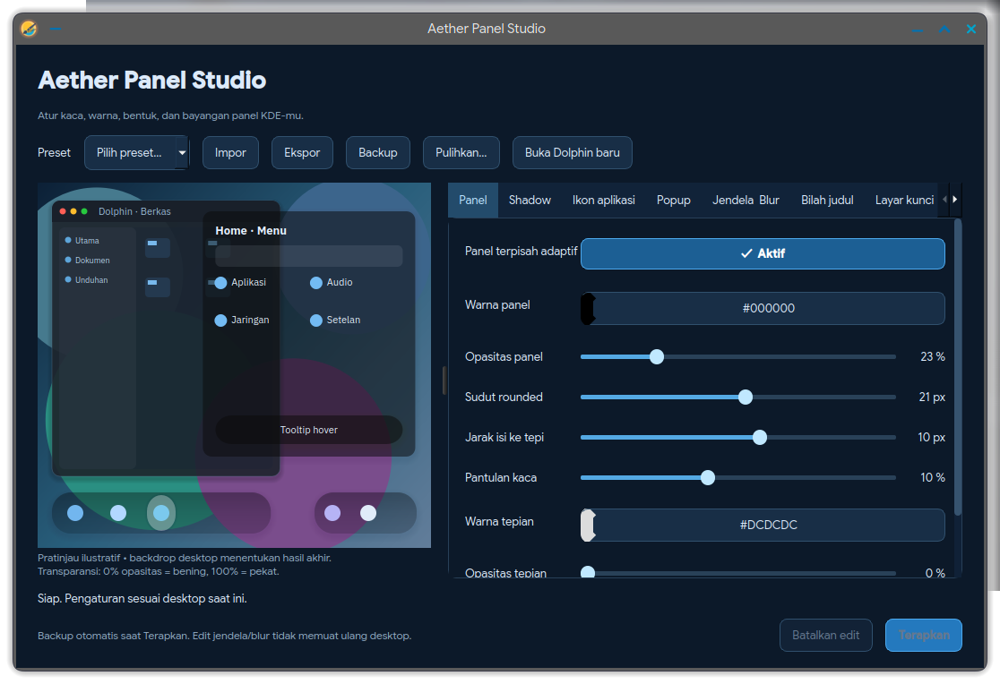
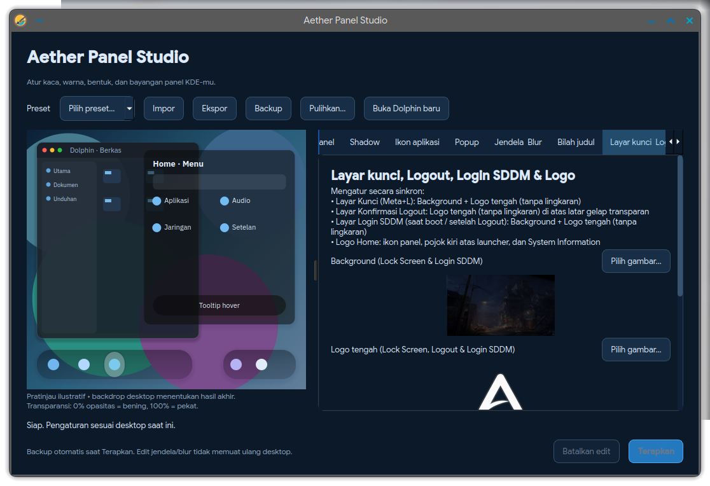
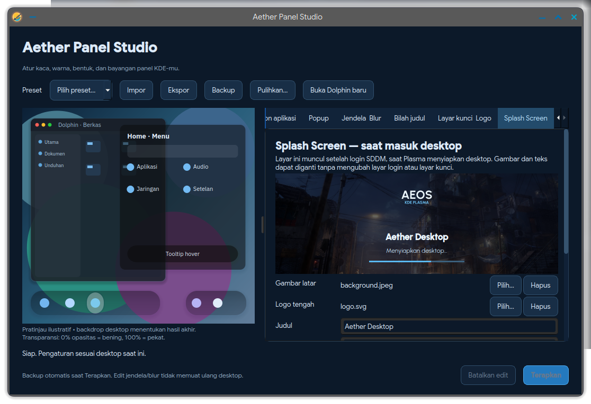
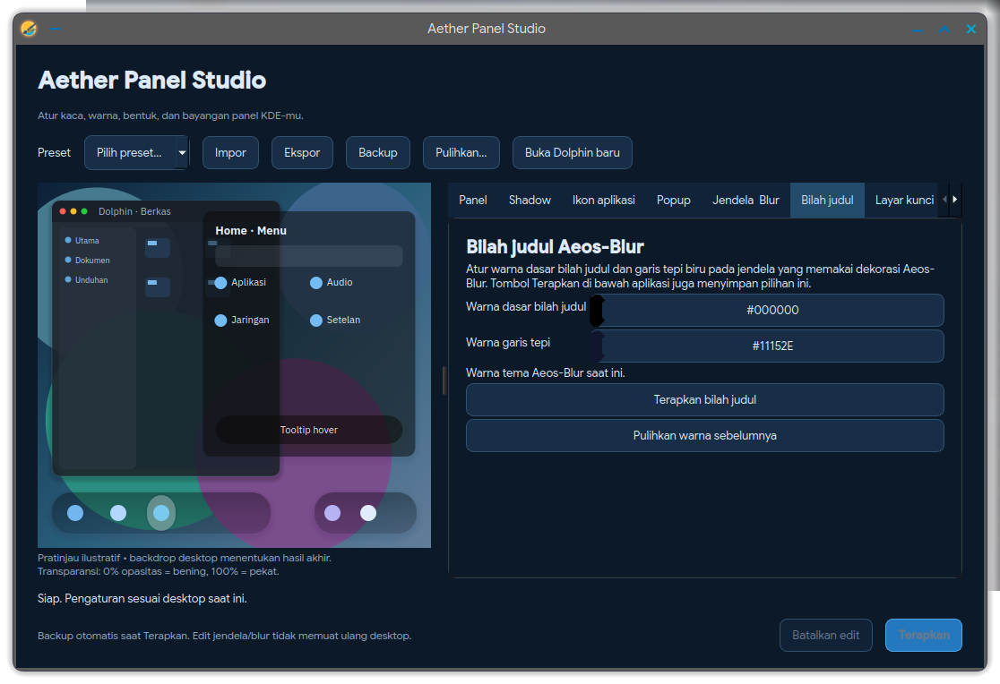

# Alur presentasi per sesi

1. Demo sesi 04: buka aplikasi dan jelaskan dua bidang latar yang lebarnya mengikuti isi; kontainernya satu panel Plasma.
2. Jelaskan sesi 01/02: font dan tema ikon berasal dari aset; pilihan tersimpan terpisah dari gambar.
3. Tunjukkan sesi 03: Aeos, Aeos-Blur dan Kvantum AetherGlass punya peran berbeda. Opasitas mengatur tembus pandang; compositor menjalankan blur.
4. Tunjukkan sesi 05: setiap kontrol Studio mempunyai key konfigurasi atau file tujuan, dijabarkan pada peta fitur.
5. Demo sesi 06/07: Home, lock/logout, SDDM dan splash memiliki konfigurasi berbeda.
6. Tunjukkan sesi 09/10: integrasi Agentic AI Harness (`agy`, `codex`, `hermes`, `opencode`, `aether-voice` offline) dan branding boot/installer (*Try or Install Aether OS*).
7. Tutup dengan sesi 11: `/etc/skel` menyiapkan akun baru; hasil remaster diuji lewat boot Live & instalasi VM.

## Screenshot antarmuka yang sudah diambil

